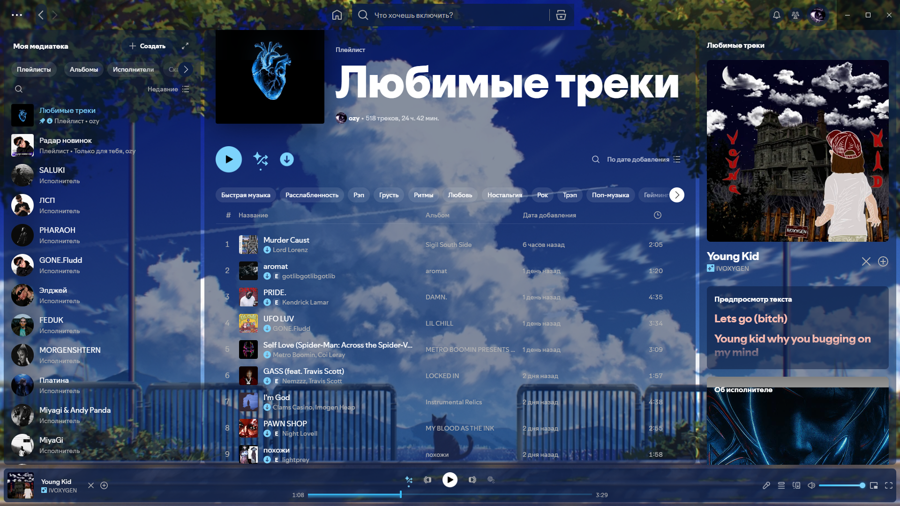

# Spotify Summer Sky

Переработанная версия темы [Summer Sky](https://github.com/Adrien5902/SpicetifyCat/tree/main/themes/Summer_Sky) из [SpicetifyCat](https://github.com/Adrien5902/SpicetifyCat) от Adrien5902 для [Spicetify](https://spicetify.app). Тема сделана не с нуля: оригинал пересобран в тёмно-синий прозрачный вид. В комплекте строка прогресса, которая движется как живая вода.

[English version](README.md)


**Было:** оригинальная Summer Sky от Adrien5902.


**Стало:** эта версия на той же странице, темнее и прозрачнее.



*Обложка с синим сердцем личная и в тему не входит. После установки будет оригинальная обложка от Adrien5902.*

Каждая часть работает без другой.

## Установка

Нужен Spicetify. Выполни команды в PowerShell из папки репозитория.

### Тема

```powershell
Copy-Item .\SummerSky "$env:APPDATA\spicetify\Themes\SummerSky" -Recurse
spicetify config current_theme SummerSky color_scheme Summer_Sky
spicetify config inject_css 1 replace_colors 1 inject_theme_js 1
spicetify apply
```

### Волна

```powershell
Copy-Item .\extensions\blue-wave-bar.js "$env:APPDATA\spicetify\Extensions"
spicetify config extensions blue-wave-bar.js
spicetify apply
```

Волна реагирует на громкость трека и успокаивается на паузе. Перемотка работает как обычно.

## Авторы

Тема основана на [Summer Sky](https://github.com/Adrien5902/SpicetifyCat/tree/main/themes/Summer_Sky) из [SpicetifyCat](https://github.com/Adrien5902/SpicetifyCat) от Adrien5902, лицензия MIT. Оригинал стал отправной точкой, и тему в авторском виде стоит смотреть там. Фон и картинка «Любимых треков» здесь не хранятся: `theme.js` загружает их из оригинального репозитория. Все права на них остаются у авторов, фон подписан Aeuna.

Обновления Spotify могут переименовать классы интерфейса, на которые опирается тема, поэтому после обновления что-то может перестать работать.

## Лицензия

[MIT](LICENSE)
